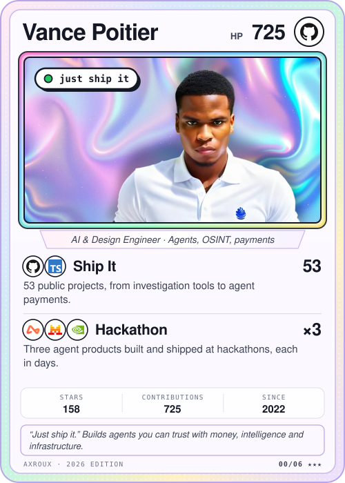
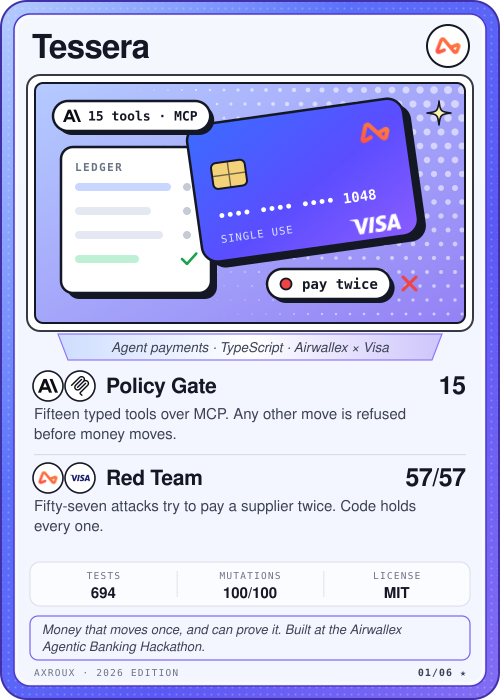
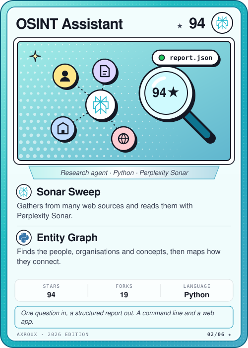
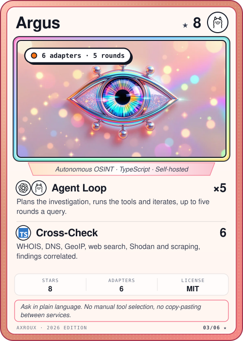
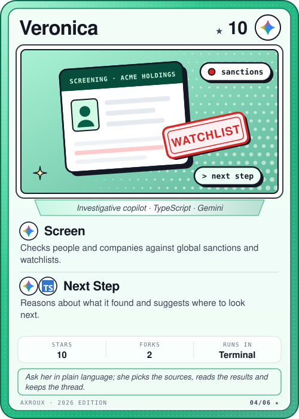
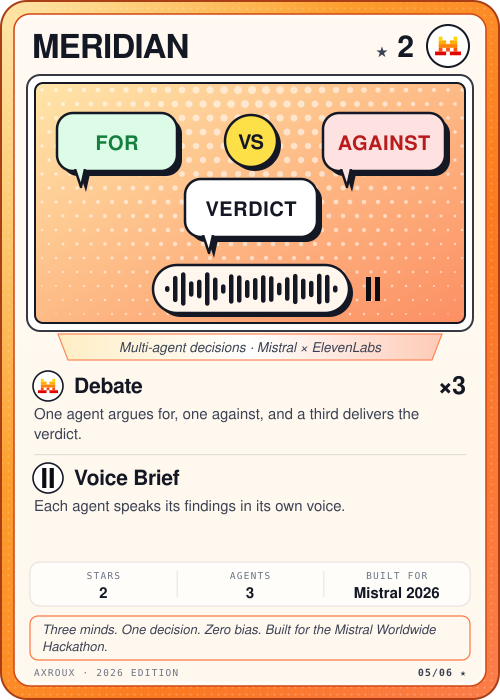
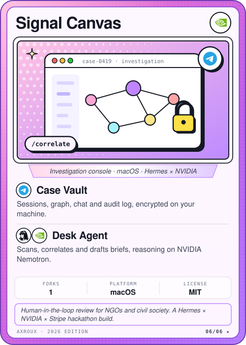
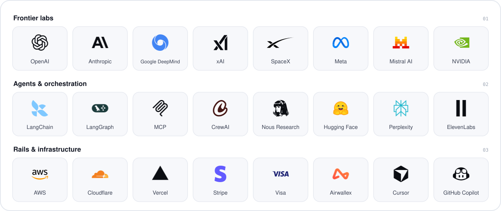

<table>
  <tr>
    <td width="38%" valign="top">
      
    </td>
    <td valign="top">

### Hey, I'm Vance 👋

AI & Design Engineer. I build agents you can trust with money, intelligence and infrastructure, and the interfaces people use to watch them work.

I recently shipped **[Tessera](https://github.com/AXRoux/tessera)** for the **Airwallex Agentic Banking Hackathon**: the control layer between AI agents and a treasury. Policy decides what an agent may do, a person signs what only a person should, and every move is proved on a ledger.

**Focus** &nbsp;agent safety · MCP · OSINT · payments
**Open to** &nbsp;building agents for mission-critical work
**Ask me about** &nbsp;OSINT, learning languages, travel hacks

   

</td>
  </tr>
</table>

### The deck

  
  
  

  
  
  

### The agentic stack

Cards are drawn by <a href="scripts/build.mjs">scripts/build.mjs</a> and refreshed daily from the GitHub API · logos belong to their owners

