<a href="https://vancepoitier.me"></a>

  <a href="https://vancepoitier.me"><picture><source media="(prefers-color-scheme: dark)" srcset="assets/dark/btn-web.svg"></picture></a>&nbsp;
  <a href="https://x.com/vancepoitier"><picture><source media="(prefers-color-scheme: dark)" srcset="assets/dark/btn-x.svg"></picture></a>&nbsp;
  <a href="https://linkedin.com/in/vance-poitier"><picture><source media="(prefers-color-scheme: dark)" srcset="assets/dark/btn-linkedin.svg"></picture></a>&nbsp;
  <a href="mailto:vvp15@pm.me"><picture><source media="(prefers-color-scheme: dark)" srcset="assets/dark/btn-email.svg"></picture></a>

<picture><source media="(prefers-color-scheme: dark)" srcset="assets/dark/stats.svg"></picture>

 

<picture><source media="(prefers-color-scheme: dark)" srcset="assets/dark/section-principles.svg">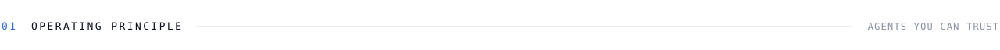</picture>
<picture><source media="(prefers-color-scheme: dark)" srcset="assets/dark/loop.svg"></picture>

 

<picture><source media="(prefers-color-scheme: dark)" srcset="assets/dark/section-work.svg"></picture>

  <a href="https://github.com/AXRoux/tessera"><picture><source media="(prefers-color-scheme: dark)" srcset="assets/dark/projects/tessera.svg">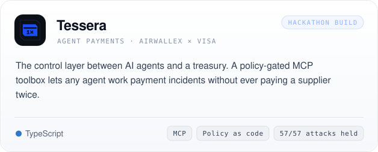</picture></a>
  <a href="https://github.com/AXRoux/OSINT-Assistant"><picture><source media="(prefers-color-scheme: dark)" srcset="assets/dark/projects/OSINT-Assistant.svg">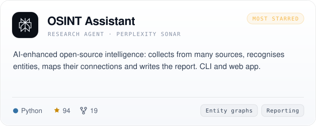</picture></a>

  <a href="https://github.com/AXRoux/argus-os"><picture><source media="(prefers-color-scheme: dark)" srcset="assets/dark/projects/argus-os.svg">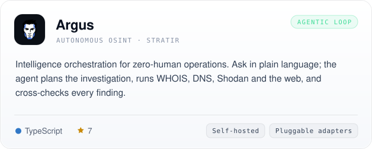</picture></a>
  <a href="https://github.com/AXRoux/veronica-osint"><picture><source media="(prefers-color-scheme: dark)" srcset="assets/dark/projects/veronica-osint.svg">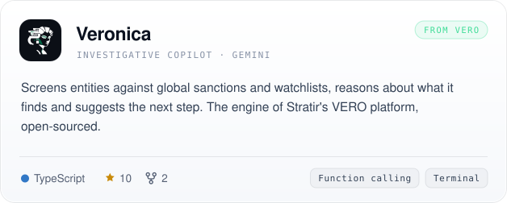</picture></a>

  <a href="https://github.com/AXRoux/meridian"><picture><source media="(prefers-color-scheme: dark)" srcset="assets/dark/projects/meridian.svg">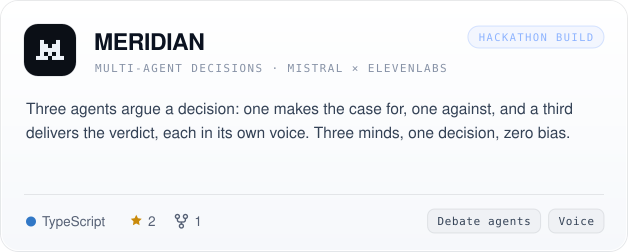</picture></a>
  <a href="https://github.com/AXRoux/signal-canvas"><picture><source media="(prefers-color-scheme: dark)" srcset="assets/dark/projects/signal-canvas.svg">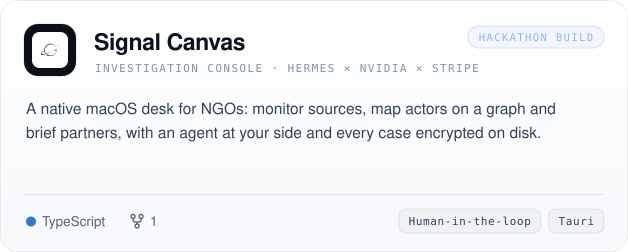</picture></a>

Also: <a href="https://github.com/AXRoux/WhatsMyName-Web">WhatsMyName-Web</a> · <a href="https://github.com/AXRoux/sigint-decoder">sigint-decoder</a> · <a href="https://github.com/AXRoux/AllSourceIntelligenceHub">AllSourceIntelligenceHub</a> · <a href="https://github.com/AXRoux?tab=repositories&type=source">every project →</a>

 

<picture><source media="(prefers-color-scheme: dark)" srcset="assets/dark/section-signal.svg">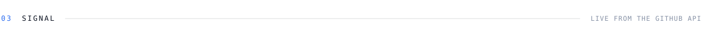</picture>
<picture><source media="(prefers-color-scheme: dark)" srcset="assets/dark/activity.svg"></picture>

 

<picture><source media="(prefers-color-scheme: dark)" srcset="assets/dark/section-stack.svg"></picture>
<picture><source media="(prefers-color-scheme: dark)" srcset="assets/dark/stack.svg"></picture>

 

<a href="https://vancepoitier.me"><picture><source media="(prefers-color-scheme: dark)" srcset="assets/dark/footer.svg"></picture></a>

<!-- Every image here is generated by scripts/build.mjs from the GitHub API and refreshed daily by .github/workflows/refresh.yml. Logos are trademarks of their owners. -->
